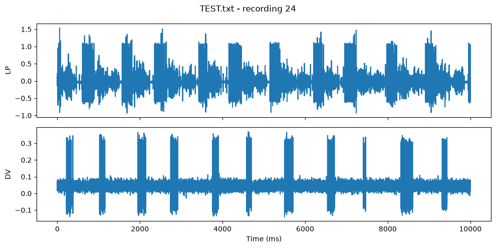
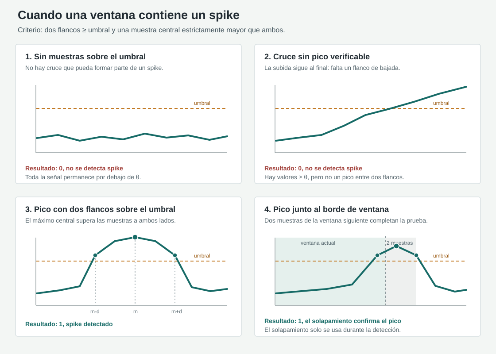
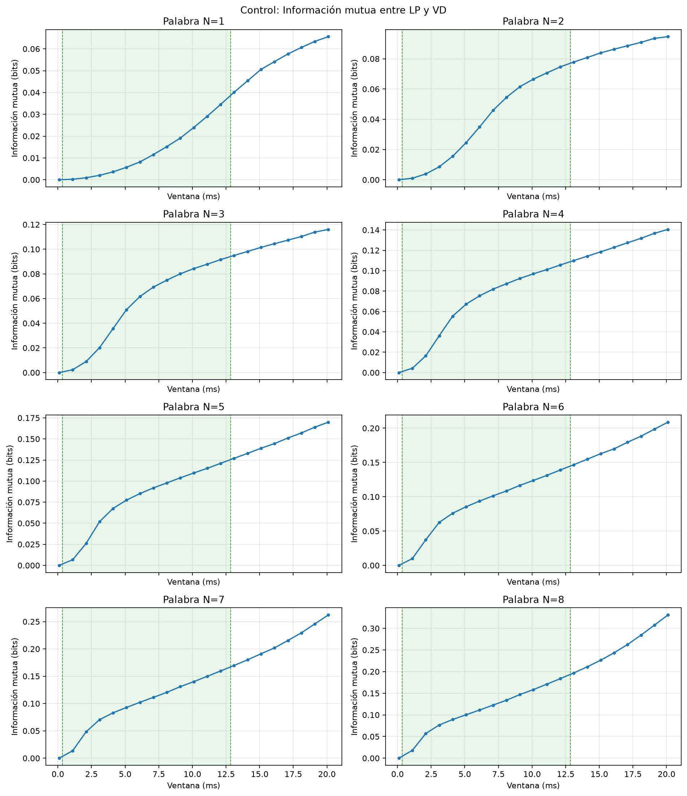
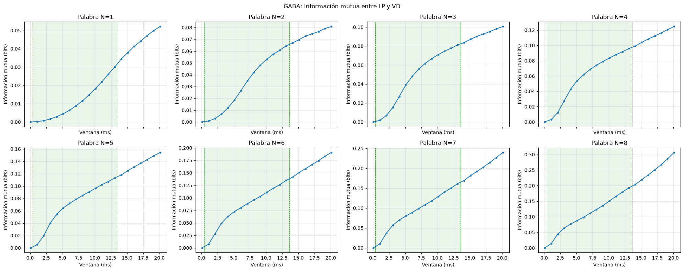
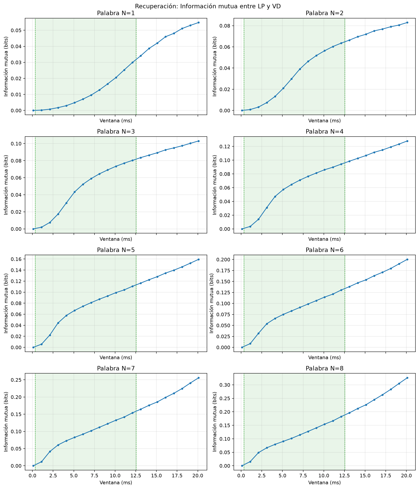
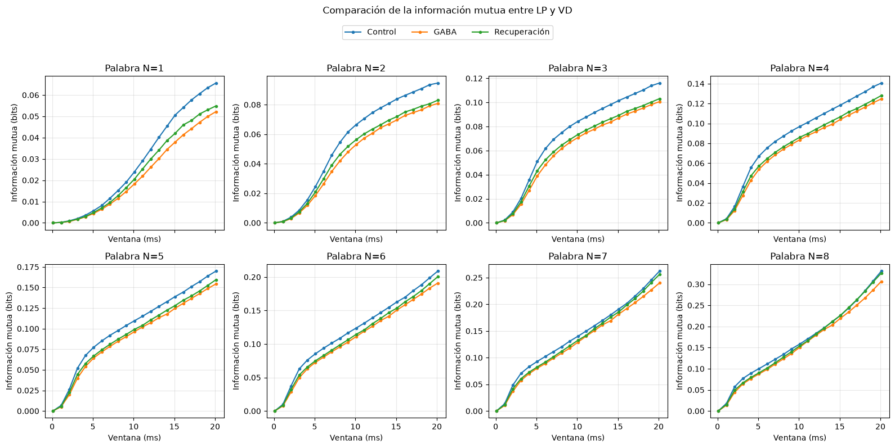
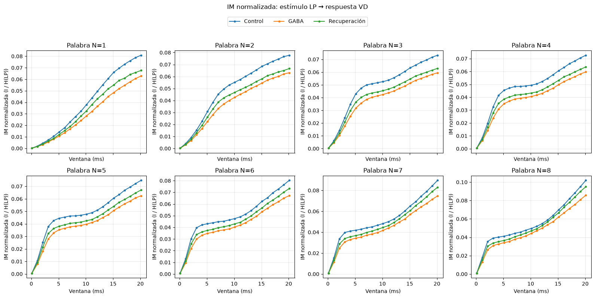
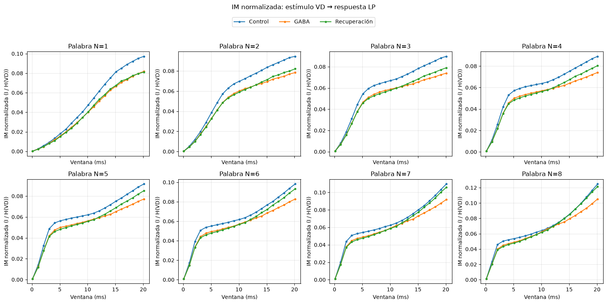

# Análisis de la información mutua entre las neuronas VD y LP del sistema nervioso estomatogástrico del cangrejo azul

## Resumen

En neurociencia, el estudio de los sistemas neuronales suele apoyarse en la teoría de la información (Shannon, 1948; Cover & Thomas, 2006) y, en particular, en el análisis de la información mutua entre las neuronas que los componen. En este informe presentamos el desarrollo experimental, el tratamiento y análisis de los datos empleados para estudiar la información mutua en el sistema nervioso estomatogástrico (STNS, por sus siglas en inglés) (Marder & Bucher, 2007) del cangrejo azul (*Callinectes sapidus*).

El STNS es un generador central de patrones (CPG, por sus siglas en inglés) (Latorre et al., 2002; Rodríguez et al., 2002), un tipo de sistema neuronal ampliamente estudiado por la regularidad de su actividad global. Los CPG generan ritmos de señales eléctricas de manera autónoma, lo que permite estudiarlos fuera del organismo. Aprovechamos esta propiedad para analizar la información mutua entre las neuronas VD y LP y comparar su actividad en tres condiciones: espontánea, durante la aplicación reiterada de un estímulo y durante la recuperación posterior, sin estímulo.

## Marco teórico

### Modelos neuronales, STNS y CPG
#### Actividad eléctrica neuronal y spikes

Las neuronas transmiten señales mediante cambios en su potencial eléctrico. Cuando estos cambios superan el umbral de excitación se producen potenciales de acción, o *spikes*, que pueden representarse por sus tiempos de ocurrencia como un tren de eventos. En un registro extracelular, la señal observada depende también de la preparación y del electrodo; por ello, el análisis de eventos requiere un criterio de detección consistente (Marder & Bucher, 2007; Strong et al., 1998).

#### Sistema nervioso estomatogástrico (STNS) del cangrejo azul

El STNS es un circuito neuronal de crustáceos que controla movimientos rítmicos del sistema digestivo. Su organización relativamente accesible y la persistencia de patrones rítmicos en preparaciones aisladas lo han convertido en un modelo para estudiar cómo las propiedades neuronales y las conexiones sinápticas producen actividad coordinada (Marder & Bucher, 2007). En este proyecto se estudian registros del STNS del cangrejo azul, *Callinectes sapidus*.

#### Generadores centrales de patrones (CPG) y neuronas VD y LP

Un generador central de patrones (CPG) es una red neuronal capaz de producir actividad rítmica sin requerir una señal rítmica externa. En el STNS, el circuito pilórico genera secuencias coordinadas de actividad en neuronas motoras. VD y LP forman parte de la actividad registrada en este circuito; sus spikes pueden organizarse en ráfagas y fases rítmicas. El análisis de intervalos entre spikes y de ráfagas ofrece descripciones complementarias de estos patrones (Latorre et al., 2002; Rodríguez et al., 2002).

### Codificación neuronal y discretización de señales
#### Codificación por eventos (spike trains) y secuencias binarias

Un tren de spikes conserva los instantes de los eventos, mientras que una secuencia binaria resume cada intervalo como presencia o ausencia de al menos un spike. Esta representación facilita comparar canales y calcular estadísticas, pero pierde información sobre la forma y amplitud de cada spike y sobre su posición exacta dentro de la ventana. La elección de la representación determina, por tanto, qué aspectos de la actividad pueden detectarse como dependencias (Strong et al., 1998; Rodríguez et al., 2002).

#### Ventana temporal Δt y palabras (n-gramas)

La duración de la ventana, Δt, fija la resolución temporal de la secuencia: ventanas pequeñas conservan mejor la localización de los eventos, mientras que ventanas grandes pueden agrupar eventos cercanos y ocultar su orden. Al agrupar símbolos binarios consecutivos en palabras de longitud N, o n-gramas, se representan patrones temporales más extensos y se pueden comparar secuencias alineadas de VD y LP. Al crecer N también aumenta el número de palabras posibles, de modo que la estimación a partir de registros finitos exige cautela (Strong et al., 1998; Paninski, 2003).

### Teoría de la información
#### Entropía de Shannon y entropía de bloque

La entropía de Shannon cuantifica la incertidumbre de una variable aleatoria: es baja cuando unos pocos resultados concentran la probabilidad y alta cuando la probabilidad está más repartida (Shannon, 1948; Cover & Thomas, 2006). La entropía de bloque aplica esta idea a secuencias de N símbolos; así incorpora tanto la variabilidad de cada símbolo como los patrones temporales que aparecen en la palabra. Su estimación empírica depende de cuántas observaciones haya para cubrir los patrones posibles (Paninski, 2003).

#### Información mutua

La información mutua cuantifica cuánto reduce la observación de una variable la incertidumbre sobre otra. Es cero cuando las variables son independientes y es simétrica: intercambiar los canales no cambia su valor. Aplicada a palabras alineadas, mide la dependencia estadística compartida entre sus patrones, pero no identifica por sí sola un mecanismo ni una dirección causal (Cover & Thomas, 2006; Rodríguez et al., 2001). 

## Diseño experimental

### Sistema biológico y preparación

El estudio se realiza sobre el sistema nervioso estomatogástrico (STNS) del cangrejo azul (Callinectes sapidus), una red de tipo CPG (generador central de patrones) que produce actividad rítmica trifásica de forma autónoma. Se trabaja in vitro: el sistema nervioso se extrae del organismo y se mantiene en una cámara de registro bajo un estereomicroscopio, con control de temperatura y sobre una mesa de aislamiento de vibraciones.

Se registra de forma extracelular en los nervios motores del STNS:

 - LVN (nervio ventricular lateral): contiene la actividad de la neurona LP, junto con PY y PD.
 - MVN (nervio ventricular medial): contiene la actividad de la neurona VD, junto con IC.
 - IVN (nervio ventricular inferior): también se registra, aunque el análisis se limita a LP y VD.

Los registros extracelulares miden la caída de potencial entre dos electrodos a lo largo de la resistencia del medio, lo que permite identificar los spikes y los bursts de cada neurona.

### Estimulación con GABA mediante microinyección

La perturbación experimental consiste en la inyección de GABA (neurotransmisor) sobre el circuito. Para ello se emplea un microinyector construido en el laboratorio, controlado electrónicamente y dirigido sobre la preparación. El control en tiempo real se realiza con un sistema de sinapsis artificiales y estimulación en tiempo real, que permite que la inyección dependa de la propia actividad de la red.

La inyección se dispara a partir de los bursts de la neurona VD (trigger), aplicando la inyección durante 0.4ms apartir del cuarto spike dek burst. Estableciendo un lazo cerrado entre actividad y estimulación.

### Protocolo temporal

Cada experimento se divide en tres fases, que se corresponden con las condiciones del proyecto:

 1. Control (actividad espontánea): 1 minuto.
 2. GABA (estimulación repetida): 2 minutos de inyección.
 3. Recuperación: 3 minutos de registro posterior.

Tras cada experimento se deja un periodo de 10 minutos para la recuperación total de la preparación antes de repetir el protocolo con otra modalidad. Los ficheros de datos del repositorio (TrozoC, TrozoG, TrozoR) corresponden a estas tres fases: control, GABA y recuperación, agrupados en cadenas por condición.

## Tipo de discretización 1: codificación binaria de spikes

### Tratamiento de datos

El objetivo del tratamiento de los datos es transformar las señales, originalmente pseudocontinuas, en representaciones discretas que permitan calcular la entropía y la información mutua entre canales. En este trabajo se consideran dos modelos de discretización, que se presentan por separado.

Este primer método parte del supuesto de que los eventos que contienen la información relevante son los spikes. Cada registro se divide en ventanas temporales y cada una se representa con un valor binario: 1 si contiene un spike y 0 si no lo contiene. A partir de las frecuencias de aparición de las palabras formadas por estos símbolos se estiman sus probabilidades. En las secciones siguientes se describe cómo se detectan los spikes y cómo se realiza el cálculo.

La discretización permite construir n-gramas para calcular la entropía y la información mutua. El análisis se centra en la evolución de la entropía de bloque de cada canal y de la información mutua entre VD y LP, por separado para las tres fuentes de datos, a medida que aumenta la longitud de los n-gramas.

#### Descripción de los datos

Para cada condición del experimento se obtienen dos canales simultáneos, LP y VD, con trenes de spikes agrupados en bursts rítmicos claramente identificables. Las señales se muestrean a 0,1 ms por muestra y se segmentan en grabaciones de 100 000 muestras para el análisis, como se puede ver en la imagen.

#### Umbral de detección de spikes

Como se observa en la imagen, los spikes corresponden a variaciones extremas del potencial eléctrico respecto de la actividad habitual del canal. Por tanto, es posible distinguirlos mediante un umbral que identifique los valores asociados a estos eventos. Un umbral adecuado debe considerar tanto el comportamiento general de la señal como sus valores extremos. Desde el punto de vista estadístico, esto puede expresarse como una combinación de una medida de tendencia central y otra de los valores extremos.

En las pruebas realizadas, el punto medio entre la media y el máximo de cada registro, denominado `mean_max` local, separa satisfactoriamente ambas regiones. En la figura, este umbral se muestra en naranja.

Al calcular un umbral con todos los datos del canal, el máximo puede aumentar considerablemente al incorporar más registros, mientras que la media tiende a variar menos. Para limitar la influencia de valores extremos, definimos el umbral global como el punto medio entre la media de todos los datos y el menor de los máximos de cada registro:

$$
\operatorname{mean\_max}_{\mathrm{global}} = \frac{\operatorname{mean}(\mathrm{data\_source}) + \min_{i \in \mathrm{records}}\left(\max(\mathrm{record}_i)\right)}{2}.
$$

En los datos analizados, se observa que $\operatorname{mean\_max}_{\mathrm{global}} \leq \operatorname{mean\_max}_{i,\mathrm{local}}$ para casi todos los registros $i$; la línea negra de la figura muestra el umbral global. Esta relación no está garantizada en general, pues las medias locales pueden variar. Cuando se cumple, cualquier spike detectado con el umbral local también queda por encima del umbral global.

Con las siguientes tablas se puede hacer una comparación del resultado de esta redefinición del `global_mean_max`:

| Canal | Media | Máximo | `mean_max` |
|:--|--:|--:|--:|
| LP | -0.033591 | 1.540833 | 0.753621 |
| VD | 0.043612 | 0.369568 | 0.206590 |
:`Registro 24`

| Canal | Media | Máximo |`old_mean_max`| `mean_max` |
|:--|--:|--:|--:|--:|
| LP | -0.033512 | 1.665039 | 0.815764 | 0.666685 |
| VD | 0.043721 | 1.351624 | 0.697673 | 0.199626 |
:`Global`

**Nota.** `mean_max_global` es un vector con un umbral por canal de la fuente de datos. En este informe, el nombre puede referirse al vector o al umbral de un canal concreto; el contexto permite distinguir ambos casos.

#### Ventana temporal para la discretización

La duración de la ventana temporal, $\Delta t$, determina la resolución con la que se representa cada tren de spikes mediante una secuencia binaria. Los registros se muestrean cada $0{,}1\,\mathrm{ms}$, que es el incremento empleado en el barrido de ventanas.

Al aumentar $\Delta t$, pueden quedar varios spikes dentro de una misma ventana. Como la discretización asigna un único valor binario a cada ventana, esos eventos se representan como uno solo y se pierden distinciones entre spikes. Para limitar esta pérdida, primero se detectan los tiempos de los spikes a partir de los cruces del umbral. En cada canal se calcula la menor separación temporal entre spikes consecutivos, que sirve como inicio del barrido individual. A partir de ahí, la ventana aumenta en pasos de $0{,}1\,\mathrm{ms}$. En cada paso, los spikes que caen en una misma ventana se cuentan como un único evento. La pérdida relativa se calcula como

$$
L(\Delta t) =
\frac{S_{\mathrm{total}} - S(\Delta t)}{S_{\mathrm{total}}}\times 100\,\%,
$$

donde $S_{\mathrm{total}}$ es el número total de spikes detectados antes de agruparlos en ventanas y $S(\Delta t)$ es el número de eventos que quedan representados al discretizar con la ventana $\Delta t$. El barrido se detiene cuando la pérdida supera el $5\,\%$; se selecciona como límite superior la última ventana evaluada cuya pérdida no supera ese porcentaje. Tanto la separación mínima como el límite superior se calculan por canal y estado, y pueden diferir entre ellos. Los valores obtenidos son:

| Estado | Canal | Separación mínima entre spikes (ms) | Límite superior individual (ms) |
|:--|:--|--:|--:|
| Control | LP | 1,35 | 14,35 |
| Control | VD | 0,35 | 12,85 |
| GABA | LP | 0,40 | 14,00 |
| GABA | VD | 6,05 | 13,65 |
| Recuperación | LP | 1,95 | 14,35 |
| Recuperación | VD | 0,35 | 12,55 |

El cálculo de información mutua requiere comparar palabras construidas a partir del mismo número de ventanas en ambos canales. Por ello, para cada estado se usa un único intervalo común. Su límite inferior es la menor de las dos separaciones mínimas entre spikes, y el superior se obtiene con un barrido común, conservando solo ventanas para las que la pérdida no supera el $5\,\%$ en ninguno de los canales:

$$
\Delta t_{\min,\mathrm{común}} =
\min\!\left(\Delta t_{\min,\mathrm{VD}},
           \Delta t_{\min,\mathrm{LP}}\right).
$$

| Estado | Inicio común (ms) | Última ventana común admisible (ms) | Pérdida LP (%) | Pérdida VD (%) | Intervalo evaluado  |
|:--|--:|--:|--:|--:|:--|
| Control | 0,35 | 12,85 | 2,46 | 4,86 | 0,35–12,85 ms |
| GABA | 0,40 | 13,60 | 4,17 | 4,83 | 0,40–13,65 ms |
| Recuperación | 0,35 | 12,55 | 2,17 | 4,86 | 0,35–12,55 ms |

En cada estado, ambos canales se discretizan con cada uno de los tamaños de ventana de su intervalo común, de modo que sus secuencias quedan alineadas y tienen la misma longitud. Los intervalos pueden diferir entre estados porque dependen de los spikes registrados en cada uno.

Este criterio define el intervalo admisible de ventanas, pero no determina por sí solo cuál ofrece la mejor estimación de información mutua. Para ello, se calcula la información mutua a lo largo del intervalo común y se analiza cómo varía con $\Delta t$.

#### Registro de eventos (spikes)

Una vez definida la ventana temporal, cada registro se divide en ventanas y se etiqueta cada una con un valor binario. Sin embargo, que una ventana contenga muestras por encima del umbral no basta para declararla como spike: puede contener solo el flanco ascendente o descendente de un evento.

Para caracterizar un spike, el detector busca tres muestras de tal manera que dos de ellas igualen o superen el umbral y una muestra central estrictamente mayor que ambos. Si para el análisis consideramos la función de potencial como una función continua, estas condiciones nos garantizan que la función es cóncava en el sub-intervalo de las muestras, además garantiza que en el mismo intervalo deben existir valores simetricos y por el teorema de Rolle un máximo local, no necesariemente la muestra central. En otras palabras, para algún desplazamiento $d > 0$ y una posición central $m$, se requiere que

$$
x[m-d] \geq \theta, \qquad x[m+d] \geq \theta, \qquad
x[m] > \max\bigl(x[m-d], x[m+d]\bigr),
$$

donde $x$ es la señal y $\theta$ el umbral del canal. La muestra central representa la concavidad; las otras dos confirman que la señal asciende y desciende dentro de la ventana. Basta con que exista un triplete que cumpla estas condiciones para etiquetar la ventana como spike. Por ello, una subida que continúa hasta el final de la ventana no se acepta: todavía no hay un flanco de bajada que permita verificar el pico.

En el borde entre ventanas, el detector añade las dos primeras muestras de la ventana siguiente al análisis de la ventana actual. Este solapamiento se usa solo para decidir si hay un spike, no modifica el tamaño de las ventanas ni la secuencia binaria resultante. Permite verificar un pico cuyo flanco de bajada cae justo después del límite, evitando perderlo por el corte temporal.

Esta verificación es importante porque la discretización convierte la señal en una secuencia de presencia/ausencia de spikes. Si cualquier cruce del umbral se contara como evento, fragmentos de spikes sin pico producirían falsos positivos. Estos alterarían las frecuencias de los n-gramas y, por tanto, las estimaciones de entropía e información mutua.

#### N-gramas e información mutua

El análisis de detección de eventos parte de la hipótesis de que el ritmo del generador central de patrones (CPG) se establece mediante la comunicación entre las neuronas del STNS, en la que participan VD y LP. Una representación binaria de cada ventana conserva si hubo o no un spike, pero no describe el orden de los eventos ni posibles dependencias temporales. Para estudiar esos patrones, agrupamos símbolos consecutivos en palabras de longitud $N$, también llamadas $N$-gramas.

Sea $X^N$ la palabra de VD y $Y^N$ la palabra de LP observadas en el mismo conjunto de $N$ ventanas consecutivas. Para una longitud fija $N$, estimamos sus probabilidades a partir de las frecuencias relativas en todas las posiciones válidas del registro. Si el registro discretizado tiene longitud $T$, hay $T-N+1$ palabras posibles por canal. Definimos el conteo conjunto como

$$
C_N(x_N,y_N) = \sum_{t=1}^{T-N+1}
  \mathbb{1}\!\left[X_N^{(t)}=x_N \,\wedge\, Y_N^{(t)}=y_N\right],
$$

de modo que

$$
\hat{p}_N(x_N,y_N) = \frac{C_N(x_N,y_N)}{T-N+1}, \qquad
\hat{p}_N(x_N) = \sum_{y_N}\hat{p}_N(x_N,y_N), \qquad
\hat{p}_N(y_N) = \sum_{x_N}\hat{p}_N(x_N,y_N).
$$

Estas frecuencias relativas son estimaciones empíricas de las probabilidades; al sustituirlas en la definición de información mutua obtenemos el estimador de frecuencias:

Para cada canal, la entropía de las palabras de longitud $N$ es

$$
H_N(X) = -\sum_{x_N} \hat{p}_N(x_N)\log_2\hat{p}_N(x_N).
$$

Así, las etiquetas describen la longitud configurada `word_length = N`. La suma se toma sobre las palabras observadas con probabilidad conjunta positiva. Las palabras se construyen sincronizadamente en ambos canales:

$$
x_N^{(t)} = \left(x_t,\,x_{t+1},\,\dots,\,x_{t+N-1}\right), \qquad
y_N^{(t)} = \left(y_t,\,y_{t+1},\,\dots,\,y_{t+N-1}\right)
$$

Aprovechando el calculo de las entropias reducimos la estimación de la información mutua usando la siguiente identidad: 

$$
\hat{I}_N(VD,LP) = H_N(X) + H_N(Y) - H_N(X,Y)
$$

Estas cantidades dependen también de la duración de la ventana temporal, $\Delta t$, pues esta determina la discretización de los datos. Para destacar esta dependencia podríamos escribir $H_N(X;\Delta t)$ y $\hat{I}_N(VD,LP;\Delta t)$, pero omitiremos $\Delta t$ en la notación general para mantener las expresiones sencillas. En los resultados analizaremos cómo varía la información mutua al cambiar este parámetro. Al estar alineadas las palabras, la información mutua es simétrica: $\hat{I}_N(VD,LP)=\hat{I}_N(LP,VD)$.

Como las entropías marginales y la información mutua se calculan a partir de las mismas palabras de longitud $N$, se cumple $0 \leq \hat{I}_N(VD,LP) \leq \min(H_N(VD), H_N(LP))$.

En términos de las distribuciones verdaderas, la información mutua de las palabras no disminuye al aumentar $N$. En efecto, $X^N$ y $Y^N$ se obtienen como prefijos de $X^{N+1}$ y $Y^{N+1}$; añadir variables a cualquiera de los dos vectores no puede reducir la información mutua. Por tanto,

$$
I_{N+1}(VD,LP) \geq I_N(VD,LP).
$$

La desigualdad puede ser una igualdad si los símbolos añadidos no aportan información nueva. Esta propiedad se refiere a las distribuciones verdaderas. En un registro finito, las frecuencias se vuelven a calcular para cada longitud y el número de posiciones válidas disminuye de $T-N+1$ a $T-N$; por variabilidad muestral, el estimador $\hat{I}_N$ no tiene por qué crecer en cada paso. Además, al aumentar $N$ crece rápidamente el número de palabras posibles, por lo que algunas aparecen pocas veces o no aparecen; las estimaciones para longitudes grandes deben interpretarse con cautela.

Para interpretar la información mutua como una medida de transferencia relativa, normalizamos respecto de la entropía del canal que se considera estímulo. Si VD se toma como estímulo de LP, usamos

$$
E_{VD\to LP}^{(N)} = \frac{\hat{I}_N(VD,LP)}{H_N(VD)},
$$

que representa la fracción de la entropía de VD compartida con LP. Si LP se considera el estímulo de VD, la normalización correspondiente es

$$
E_{LP\to VD}^{(N)} = \frac{\hat{I}_N(VD,LP)}{H_N(LP)}.
$$

Aunque la información mutua es simétrica, estas dos cantidades normalizadas pueden diferir porque usan entropías marginales distintas. Describen información compartida relativa; por sí solas no demuestran una relación causal ni estiman una transferencia dirigida entre las neuronas.

### Resultados

#### Conclusiones de los barridos de información mutua

Para cada estado se realizaron 168 experimentos: ocho longitudes de palabra ($N=1,\ldots,8$) y 21 ventanas entre 0,1 y 20,1 ms, espaciadas 1 ms. Las figuras muestran la información mutua estimada, en bits, entre las palabras binarias alineadas de LP y VD. El sombreado verde representa el intervalo de ventana admisible obtenido con el criterio de pérdida máxima del 5 % de spikes en ambos canales.

##### Estado de control

##### Estado de inyección de GABA

##### Estado de recuperación

En los tres estados se observa un aumento de la información mutua estimada al incrementar la ventana temporal, para todas las longitudes de palabra consideradas. Asimismo, la información mutua aumenta con el tamaño de palabra \(N\). Esto puede estar relacionado con que las palabras más largas permiten representar patrones temporales más complejos, pero también dan lugar a un mayor número de combinaciones posibles. Como consecuencia, para un número fijo de observaciones, se dispone de menos muestras para estimar las probabilidades de cada patrón, lo que puede afectar a la precisión de la estimación de la información mutua.

La tendencia creciente respecto a la ventana temporal se mantiene tanto dentro como fuera de los intervalos admisibles, y no se observa un máximo seguido de una disminución en el rango representado. Por tanto, los barridos realizados no permiten identificar un máximo de información mutua ni justificar la elección de 20,1 ms como ventana óptima. No obstante, esto no implica que sea conveniente seguir aumentando el tamaño de la ventana para buscar dicho máximo. Fuera de los intervalos admisibles se supera el límite de pérdida del 5 % de los spikes establecido para cada canal, por lo que las estimaciones dejan de cumplir el criterio definido para el análisis. Además, al aumentar la ventana, se dispone de menos observaciones válidas y las probabilidades estimadas de los patrones pueden representar cada vez peor su distribución real. En consecuencia, aunque la información mutua estimada podría acabar disminuyendo para ventanas mayores, esta disminución podría deberse a las limitaciones de la estimación y no necesariamente a una reducción real de la dependencia estadística entre las neuronas.

Por ello, no sería adecuado prolongar el barrido únicamente hasta encontrar un máximo, ya que este podría reflejar los errores de estimación asociados a la escasez de datos y a la pérdida de spikes, en lugar de una característica real del sistema. En consecuencia, no es posible determinar un tamaño de ventana que maximice la información mutua a partir de los barridos realizados sin comprometer el criterio establecido de limitar al 5 % la pérdida de spikes en cada canal.

**Información mutua comparativa entre estados**

La información mutua mide cuánto se reduce la incertidumbre sobre una variable aleatoria al conocer el valor de la otra. En este caso, indica hasta qué punto conocer la palabra de una neurona permite reducir la incertidumbre sobre la palabra de la otra. Por tanto, una mayor información mutua refleja una mayor dependencia estadística entre las representaciones de ambas neuronas.

Para comparar los tres estados bajo las mismas condiciones, se considera una ventana de 12,1 ms, correspondiente al último valor muestreado incluido en los intervalos admisibles de las tres condiciones. La tabla muestra la información mutua estimada para cada tamaño de palabra y estado:

| Tamaño de palabra \(N\) | Control (bits) | GABA (bits) | Recuperación (bits) |
|---:|---:|---:|---:|
| 1 | 0,0345 | 0,0261 | 0,0299 |
| 2 | 0,0746 | 0,0607 | 0,0635 |
| 3 | 0,0916 | 0,0777 | 0,0803 |
| 4 | 0,1057 | 0,0916 | 0,0942 |
| 5 | 0,1210 | 0,1072 | 0,1106 |
| 6 | 0,1391 | 0,1264 | 0,1304 |
| 7 | 0,1597 | 0,1504 | 0,1539 |
| 8 | 0,1838 | 0,1791 | 0,1822 |

Los resultados muestran que la información mutua es mayor en el estado de control que durante la inyección de GABA, lo que indica que, en las condiciones iniciales, las palabras de ambas neuronas presentan una mayor asociación estadística. La disminución observada durante la inyección podría estar relacionada con la perturbación externa introducida por el GABA, que modificaría la dinámica del sistema y reduciría la dependencia estadística entre ambas señales.

Durante la recuperación, la información mutua aumenta respecto al estado de inyección de GABA, aunque se mantiene por debajo de los valores de control. Este comportamiento es compatible con una recuperación parcial de la asociación estadística entre las neuronas tras cesar la perturbación, sin que se alcancen por completo los niveles iniciales. En conjunto, los resultados sugieren una disminución de la dependencia estadística durante la inyección de GABA y una recuperación posterior parcial. No obstante, la información mutua por sí sola no permite establecer una relación causal entre las neuronas ni atribuir exclusivamente al GABA los cambios observados.

**IM normalizada comparativa: estímulo LP → respuesta VD**

**IM normalizada comparativa: estímulo VD → respuesta LP**

La información mutua normalizada ($I/H_{\text{estímulo}}$) permite evaluar la proporción de la incertidumbre del estímulo que es explicada por la respuesta entre el par neuronal. En ambas direcciones de análisis ($\text{VD} \to \text{LP}$ y $\text{LP} \to \text{VD}$), se observa una reducción constante de la IM normalizada tras la aplicación de GABA en comparación con el estado Control, efecto que se revierte parcialmente durante la fase de Recuperación.

Al evaluar ventanas temporales intermedias (p. ej., a 12,1 ms), los valores de IM normalizada oscilan aproximadamente entre el 3,6 % y el 6,0 % para $\text{LP} \to \text{VD}$, y entre el 5,2 % y el 7,5 % para $\text{VD} \to \text{LP}$. Esta mayor magnitud relativa al considerar VD como estímulo sugiere una representación informativa más concentrada en la respuesta de LP. No obstante, dado que la información mutua no dirigida es una medida simétrica ($I(X;Y) = I(Y;X)$), las diferencias observadas al normalizar derivan exclusivamente del denominador ($H(\text{VD}) < H(\text{LP})$) y no constituyen por sí mismas una evidencia direccional o de transferencia causal de información.

Asimismo, el incremento en la longitud de palabra ($N=1$ a $N=8$) pone de manifiesto dinámicas temporales no lineales, caracterizadas por la aparición de una meseta intermedia en ventanas de 3 a 10 ms antes de continuar su crecimiento en ventanas más prolongadas. Cabe destacar que en la dirección $\text{VD} \to \text{LP}$, la fase de Recuperación alcanza niveles muy próximos al Control para palabras largas ($N \ge 7$) en ventanas amplias, un fenómeno que se muestra menos pronunciado en la dirección inversa.

## Tipo de discretización 2: patrones de orden

### Introducción a la Discretización por Patrones de Orden

#### 1. ¿Qué son los patrones de orden?

En el análisis de series temporales complejas y no lineales, la discretización por **patrones de orden** (o *ordinal patterns*), propuesta originalmente por Bandt y Pompe (2002), es una técnica que transforma una secuencia continua de observaciones numéricas en una cadena de símbolos discretos centrándose exclusivamente en el orden relativo de los puntos vecinos en lugar de sus amplitudes absolutas.

Dado un registro continuo de voltaje $X = (x_1, x_2, \dots, x_T)$, se define un subvector de dimensión de orden $d$ (que evalúa $d+1$ puntos consecutivos) y un retardo temporal $\tau$:

$$V(t) = [x_t, \, x_{t+\tau}, \, x_{t+2\tau}, \, \dots, \, x_{t+d\tau}]$$

A este subvector $V(t)$ se le asigna un patrón ordinal único $\pi = (r_0, r_1, \dots, r_d)$, definido como la permutación de índices que ordena sus valores de menor a mayor en amplitud:

$$x_{t+r_0\tau} \le x_{t+r_1\tau} \le \dots \le x_{t+r_d\tau}$$

En aquellos casos donde dos o más muestras presentan amplitudes idénticas ($x_{r_{l-1}} = x_{r_l}$), el empate se rompe formalmente asignando precedencia al índice temporal menor ($r_{l-1} > r_l$) o introduciendo un parámetro de tolerancia al ruido $\eta$.

Para una dimensión de orden $d$, existe un alfabeto finito constituido por $(d+1)!$ posibles permutaciones o formas geométricas locales (tales como pendientes crecientes, decrecientes, picos o valles). De este modo, la trayectoria de voltaje analógico de la neurona se convierte en una secuencia simbólica discreta cuya distribución de frecuencias refleja la estructura dinámica del sistema.

---

#### 2. Justificación de la elección de Patrones de Orden frente a SAX

Aunque existen diversos métodos para la simbolización de series temporales, como la **Aproximación Simbólica Agregada (SAX)**, en este proyecto se ha optado por los patrones de orden debido a diferencias fundamentales en la naturaleza de la señal neuronal:

* **Invarianza frente a la distribución global de datos:** SAX requiere una normalización previa de la serie temporal y la división del rango de voltajes en franjas o cuantiles basados en una distribución estadística prefijada. Si la serie presenta no-estacionariedades o variaciones bruscas en la amplitud entre fases experimentales (como ocurre entre las etapas de Control, GABA y Recuperación), las fronteras de los cuantiles en SAX pueden distorsionarse. Los patrones de orden, en cambio, operan de forma puramente local sin asumir distribuciones globales a priori.
* **Captura de la geometría y dinámica local:** SAX clasifica los puntos según la región de amplitud que ocupan en el espacio de estados. Por el contrario, los patrones de orden capturan la morfología local de la onda (la forma y dirección del cambio entre muestras). En sistemas dinámicos no lineales, esta representación ordinal preserva las oscilaciones y tendencias locales de la membrana sin quedar acoplada a la escala global de amplitudes.
* **Simplicidad y eficiencia computacional:** el cálculo de la representación por patrones de orden mediante el conteo de inversiones requiere únicamente $d$ comparaciones lógicas por muestra, lo que otorga al algoritmo una complejidad lineal $O(N)$ extremadamente rápida. Esto contrasta con el coste computacional derivado de calcular las medias de segmento (PAA) y los límites de cuantiles en ventanas extensas.

---

#### 3. Ventajas frente a la discretización por Umbral Binario ($0$ y $1$)

Frente a la discretización convencional por umbral ($0$ para reposo y $1$ para *spike*), el método ordinal aporta notables ventajas teóricas y metodológicas para el cálculo de la Información Mutua:

1. **Ausencia de umbrales arbitrarios:** la discretización binaria depende críticamente de la fijación manual de un umbral de voltaje. Pequeñas fluctuaciones por ruido en fases problemáticas pueden alterar significativamente la detección de disparos. Los patrones de orden no requieren calibrar ningún umbral de voltaje.
2. **Invarianza ante transformaciones monótonas y deriva de la línea de base:** matemáticamente, para cualquier función estrictamente creciente $f$, el patrón ordinal de $X_t$ es idéntico al de $y_t = f(x_t)$. Esta propiedad inmuniza al análisis ordinal contra la deriva lenta de la línea de base (*baseline drift*) causada por los electrodos o cambios en la ganancia de los amplificadores.
3. **Preservación de la dinámica sub-umbral:** El esquema binario colapsa toda la rica dinámica eléctrica de la neurona a un evento puntual (presencia o ausencia de *spike*), descartando la información contenida en las oscilaciones sub-umbrales, despolarizaciones previas e hiperpolarizaciones posteriores. Los patrones de orden conservan la información morfológica mediante un alfabeto de $(d+1)!$ símbolos.
4. **Mayor robustez frente al ruido:** el ruido de medición gaussiano cercano al umbral arbitrario genera falsos positivos en el conteo de bits. En los patrones de orden, las pequeñas variaciones aleatorias no alteran el orden relativo de los puntos a menos que modifiquen la tendencia principal de la curva, proporcionando mayor estabilidad en la estimación de las probabilidades.

### Tratamiento de datos

Las series temporales originales del potencial eléctrico de membrana de las neuronas LP y VD están registradas a una frecuencia de muestreo de $10\,\text{kHz}$, lo que equivale a un intervalo entre muestras de $0{,}1\,\text{ms}$. Sin embargo, la dinámica fisiológica de un potencial de acción (*spike*) en estas neuronas se extiende a lo largo de aproximadamente $2\,\text{ms}$.

Aplicar la discretización ordinal directamente sobre la escala de $0{,}1\,\text{ms}$ plantea un problema de sobremuestreo:
* A esta resolución tan fina, tres o cuatro muestras consecutivas durante oscilaciones sub-umbral de reposo o derivas de voltaje generan las mismas secuencias ordinales (por ejemplo, patrones crecientes o decrecientes) que la fase ascendente o descendente de un *spike*.
* Esto provoca que los patrones ordinales queden uniformemente distribuídos en el tiempo y no reconozcan los potenciales de acción como eventos informativamente significativos, resultando en valores de Información Mutua prácticamente nulos para dimensiones de orden bajas.

#### Reducción de la resolución temporal (`media_por_ventana`)
Para adecuar la escala de los datos a la duración real del *spike*, se aplica un preprocesamiento de promediado local mediante ventanas consecutivas no superpuestas de tamaño $n$:

$$
V_{\text{reducido}}[k] = \frac{1}{n}\sum_{i=1}^{n} V[(k-1)n+i]
$$

* **Selección del parámetro $n=10$ ($1\,\text{ms}$):** Tras comparar reducciones a $1\,\text{ms}$ ($n=10$), $1{,}5\,\text{ms}$ ($n=15$) y $2\,\text{ms}$ ($n=20$), se determinó que $n=10$ ($1\,\text{ms}$) es la resolución óptima.
* **Justificación:** Incrementar la reducción por encima de $1\,\text{ms}$ ($n>10$) distorsiona la estructura biológica de la señal, generando la aparición de *spikes* falsos en la neurona LP o la supresión de *spikes* en la neurona VD por la rápida cancelación entre la despolarización y la hiperpolarización posterior.

---

### Construcción de los patrones de orden

Dado un subvector de voltaje continuo de $d+1$ puntos consecutivos extraídos de la serie reducida,
$V(t)=[v_t,v_{t+\tau},\dots,v_{t+d\tau}]$, se le asocia la permutación ordinal
$\pi=(r_0,r_1,\dots,r_d)$ que ordena sus amplitudes de menor a mayor:

$$
v_{t+r_0\tau}\leq v_{t+r_1\tau}\leq\cdots\leq v_{t+r_d\tau}
$$

Para una dimensión de orden $d$, existen $(d+1)!$ patrones de orden posibles.

#### Parámetros utilizados

1. **Retardo temporal ($\tau=1$):** Se fija $\tau=1$ muestra de la serie reducida, equivalente a un intervalo de $1\,\text{ms}$.
2. **Tratamiento de empates y tolerancia al ruido ($\eta$):** En caso de igualdad exacta de amplitud entre dos puntos ($v_i=v_j$), se rompe el empate asignando precedencia al índice temporal menor ($r_{l-1}>r_l$ si $x_{r_{l-1}}=x_{r_l}$). Para evitar que pequeñas oscilaciones causadas por ruido de cuantización alteren artificialmente los patrones, se emplea el parámetro de precisión de empates $\eta$ (`tie_precision`) en la librería `ordpy`.
3. **Validación de la cota de datos ($N$):** Para garantizar una estimación insesgada de las probabilidades ordinales, la longitud total de la serie reducida $N$ debe cumplir la restricción matemática propuesta por Bandt & Pompe:

   $$
   5(d+1)! < N
   $$

   * Con $N\approx1.638.400$ muestras tras la reducción con $n=10$, se verifica que $5\times(7+1)!=201.600<N$, mientras que para $d=8$ tendríamos $5\times9!=1.814.400>N$.
   * Por tanto, se establece **$d=7$** como la cota superior válida para el análisis.

4. **Codificación simbólica y distribución conjunta:**
   Cada una de las $(d+1)!$ permutaciones posibles de dimensión $d$ se mapea a un entero único en el rango $[0,(d+1)!-1]$. La secuencia conjunta entre las neuronas VD y LP se codifica combinando ambos índices:

   $$
   C_{\text{conjunto}}(t)
   = C_{\text{VD}}(t)\,(d+1)! + C_{\text{LP}}(t)
   $$

   A partir de esta codificación se estiman las distribuciones marginales $P(\pi_{\text{VD}})$ y $P(\pi_{\text{LP}})$, y la distribución conjunta $P(\pi_{\text{VD}},\pi_{\text{LP}})$, para calcular las entropías de Shannon y la información mutua.

#### Comportamiento según la dimensión $d$
* **Dimensiones bajas ($d\leq6$):** La información mutua resulta cercana a cero debido a que las oscilaciones continuas de fondo de la membrana generan patrones muy equidistribuidos.
* **Dimensión alta ($d=7$):** Permite construir palabras ordinales lo suficientemente largas como para diferenciar las formas de onda complejas asociadas a los *spikes* frente a la dinámica sub-umbral de reposo, capturando de forma representativa los eventos informativos entre ambas neuronas.

#### Estimación de probabilidades e información mutua

*Pendiente de documentar el cálculo de probabilidades, entropías e información mutua para esta discretización.*

### Resultados

#### Resultados por estado

*Pendiente de incorporar los resultados de control, GABA y recuperación.*

#### Comparación entre estados

*Pendiente de añadir la comparación de la información mutua entre estados.*

### Conclusiones

*Pendiente de redactar las conclusiones correspondientes a los patrones de orden.*

## Referencias

Bandt, C., & Pompe, B. (2002). Permutation entropy: A natural complexity measure for time series. *Physical Review Letters, 88*, 174102.

Fadlallah, B., Chen, B., Keil, A., & Príncipe, J. C. (2013). Weighted-permutation entropy: A complexity measure for time series incorporating amplitude information. *Physical Review E, 87*, 022911.

Keller, K., & Sinn, M. (2005). Ordinal analysis of time series. *Physica A: Statistical Mechanics and its Applications, 356*, 114.

Keller, K., Unakafov, A. M., & Unakafova, V. A. (2014). Ordinal patterns, entropy, and EEG. *Entropy, 16*(12), 6212–6239. https://doi.org/10.3390/e16126212

Cover, T. M., & Thomas, J. A. (2006). *Elements of information theory* (2nd ed.). Wiley. https://doi.org/10.1002/047174882X

Latorre, R., Rodríguez, F. B., & Varona, P. (2002). Characterization of triphasic rhythms in central pattern generators (I): Interspike interval analysis. In *Artificial neural networks—ICANN 2002* (Lecture Notes in Computer Science, Vol. 2415, pp. 160–166). Springer. https://doi.org/10.1007/3-540-46084-5_27

Marder, E., & Bucher, D. (2007). Understanding circuit dynamics using the stomatogastric nervous system of lobsters and crabs. *Annual Review of Physiology, 69*, 291–316. https://doi.org/10.1146/annurev.physiol.69.031905.161516

Paninski, L. (2003). Estimation of entropy and mutual information. *Neural Computation, 15*(6), 1191–1253. https://doi.org/10.1162/089976603321780272

Rodríguez, F. B., Latorre, R., & Varona, P. (2002). Characterization of triphasic rhythms in central pattern generators (II): Burst information analysis. In *Artificial neural networks—ICANN 2002* (Lecture Notes in Computer Science, Vol. 2415, pp. 167–173). Springer. https://doi.org/10.1007/3-540-46084-5_28

Rodríguez, F. B., Varona, P., Huerta, R., Rabinovich, M. I., & Abarbanel, H. D. I. (2001). Richer network dynamics of intrinsically non-regular neurons measured through mutual information. In *Connectionist models of neurons, learning processes, and artificial intelligence* (Lecture Notes in Computer Science, Vol. 2084, pp. 490–497). Springer. https://doi.org/10.1007/3-540-45720-8_58

Shannon, C. E. (1948). A mathematical theory of communication. *The Bell System Technical Journal, 27*(3), 379–423; *27*(4), 623–656. https://doi.org/10.1002/j.1538-7305.1948.tb01338.x

Strong, S. P., Koberle, R., de Ruyter van Steveninck, R. R., & Bialek, W. (1998). Entropy and information in neural spike trains. *Physical Review Letters, 80*(1), 197–200. https://doi.org/10.1103/PhysRevLett.80.197
